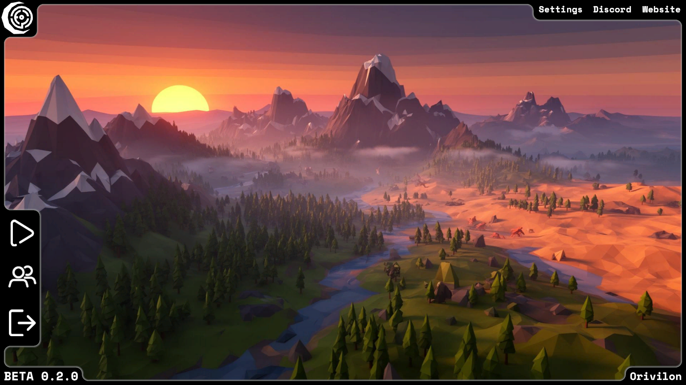
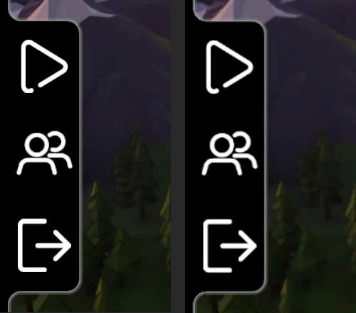
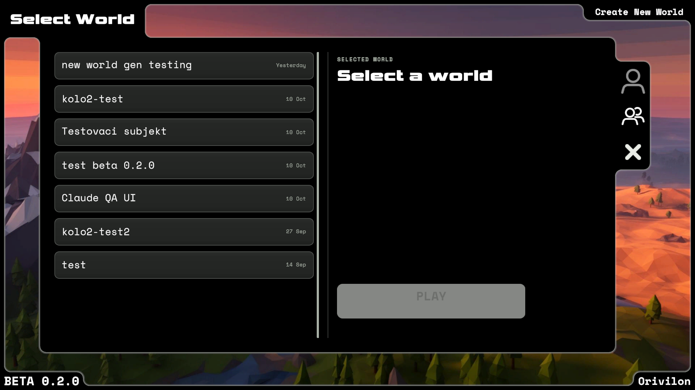
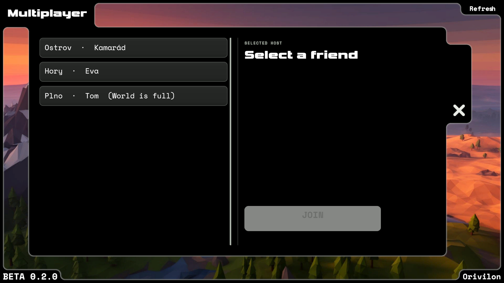
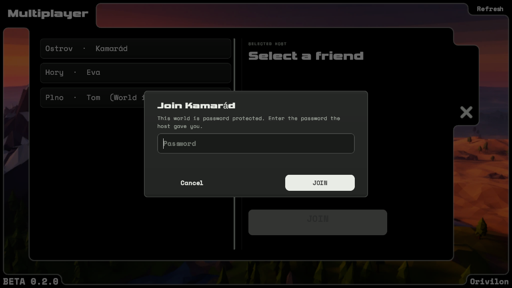

# Multiplayer – dokončení (Claude, 17.10.2026)

> **Aktualizace kola 2 je v sekci „Kolo 2“ níže.** Ta nahrazuje úschovu dropů, otisk hesla SHA-256 i Multiplayer panel z kola 1 a doplňuje mezery. Multiplayer **není hotový**: zbývá phantom loot (obejití autority) a Steam end-to-end.

Bez commitu/stagingu. Cizí rozpracované změny zachovány. Steam lobby zůstává (žádné Unity Services), NGO + CustomMessagingManager, žádná RPC.

## Příčiny
1. **Dropy**: `ItemDropService` byl čistě lokální – klient vyhazovat nesměl (`DropAllowed = !IsClient`), přebytek těžby u klienta mizel, host viděl dropy jen sám. Inventář se po síti nesynchronizuje, takže host nezná kapsy klienta.
2. **Čas**: host posílal čas jen jednou ve WorldState. Pak každý běžel vlastním cyklem; `/time` a pauza času (P) měnily jen lokální `SunRotation`. Čas se navíc neukládá, takže klient začínal se svým výchozím časem a se snímkem hosta se rozcházel.
3. **Jména**: jméno hosta chodilo klientovi **jen jednou**, a to v `OnClientConnected`. Když se zpráva ztratila nebo dorazila před vznikem vizuálu, zůstalo „Player 0“ do konce session. Dál:
   - slovník jmen se po `Shutdown` nemazal (zastaralá jména z minulé session),
   - odpojení hostitel nerozesílal (`PlayerDisconnected` existovalo, ale nepoužívalo se), takže kapsle i marker v kompasu zůstaly viset,
   - jména ze Steamu šla do TMP s rich textem.

   Na LAN trase se původní selhání nepodařilo reprodukovat (viz Mezery). Oprava proto řeší všechny cesty, kudy se jméno mohlo ztratit.
4. **Menu**: `FriendsListUI` existovala, ale její panel ležel v neaktivním PlayMenu (z hlavního menu se nedal otevřít). Seznam nečetl data lobby, takže nefiltroval plné/nekompatibilní lobby a neslučoval hráče ze stejné lobby.
5. **Heslo**: neexistovalo. NGO `ConnectionApproval` bylo vypnuté.
6. **/tp**: jen souřadnice a biomy, žádné hráčské tvary ani `/list`.

## Změny po bodech

### 1. Dropy – `NetworkWorldSync.Drops.cs` (nový), `ItemDropService`, `DroppedItem`, `PickupItem`

**Autorita:**
- O existenci a počtu kusů rozhoduje jen host. Skutečné objekty i `world/dropped_items.json` má jen on; formát savu se nemění.
- Klient má zrcadlo (`mirror`) a z něj repliky (`DroppedItem.IsReplica`). Repliky se neukládají.

**Drop od klienta:**
- `TrySpawnInFrontOfPlayer` na klientovi najde bezpečnou pózu lokálně (vlastní collidery) a pošle `DropReq` s reqId, ID itemu, počtem, pozicí a směrem.
- Volající (slot, kurzor, těžba) kusy odebere hned. Leží v úschově podle reqId, takže je nejde vyhodit dvakrát.
- Host ověří:
  - že item existuje,
  - počet 1..maxStack,
  - pozici do 40 m od poslední síťové pozice odesílatele,
  - tempo 20/s,
  - opakované reqId.
- Pak předmět vytvoří a rozešle `DropSpawn`. Při odmítnutí se úschova vrátí do inventáře, případně na prázdný kurzor.

**Více kusů, let a dosednutí:**
- Víc než maxStack se rozdělí na víc žádostí (přebytek těžby 70 → 64 + 6).
- Let simuluje ten, kdo vyhazoval, protože má kolem sebe collidery. Po dosednutí pošle `DropMove`.
- Host hlášení ověří (jen simulující klient, max. 25 m od místa vyhození) a rozešle ho ostatním.

**Sebrání:**
- Klient pošle jen kolik se mu vejde (`SpaceFor`, nikoli obsah inventáře).
- Host odečte `min(počet, místo)`, rozešle `DropCount` a teprve potvrzené kusy klient přidá.
- Zprávy se zpracovávají postupně, takže dva současné pickupy nemohou vydat stejné kusy dvakrát.
- Přidá-li klient mezitím méně kusů (plný inventář), zbytek vrátí do světa novou žádostí.

**Ostatní:**
- Host: `PickupItem` po lokálním sebrání rozešle nový počet. Drop přes Q, kurzor nebo těžbu rozešle `DropSpawn`.
- Late join: `DropSnapshot` (fragmentovaná zpráva) a aktuální čas hned po WorldState. Repliky vznikají až v načtené Game scéně.
- Disconnect: zrcadlo i repliky se smažou. Úschova se při výpadku počítá jako vyhozená, aby nevznikl duplikát.
- Offline beze změny (`SaveAll`/`LoadSaved`, ochrana 2 s / 0,5 s, kinematické dosednutí).
- Itemy nemají metadata (jen definice + počet), přenáší se tedy ID a počet.

### 2. Čas – `NetworkWorldSync.Session.cs`, `SunRotation`, `GameConsole`

**Host:**
- Rozesílá `Everlost.Time` (čas + pauza) každou 1 s.
- Okamžitě rozešle, když se čas odchýlí od očekávaného chodu (>0,05 h) nebo když se změní pauza. Tím zachytí každou cestu změny: `/time`, P, pauzu hry.
- `/time` volá `BroadcastTimeNow`.

**Klient:**
- `SunRotation.NetworkDriven` drží čas plynulý stejným tempem, ale P i `/time` jsou zakázané („Only the host can change the time of day in multiplayer.“).
- Převzetí jde přes `SetTime`, takže hýbe sluncem, intenzitou světla, ambientem, mlhou i Polyverse oblohou.
- Počáteční snímek se aplikuje i tehdy, když `SunRotation` vznikne až po zprávě (verze aplikace).

### 3. Jména – `MultiplayerManager`, `RemotePlayerController`, `CompassUI`, `MultiplayerRules.PlayerNames`

- Host znovu rozesílá jména všech hráčů každých 5 s (idempotentní, samoopravné).
- `Shutdown` maže slovník jmen.
- Odpojení: host rozešle `PlayerDisconnected`. Klient při konci spojení (`OnClientStopped`) smaže kapsle, markery i zrcadlo dropů.
- `PlayerNames.Sanitize` se aplikuje na hostu u jmen od klientů, u každého přijatého jména, u vlastního jména i v konzoli:
  - odstraní řídicí znaky,
  - ořízne na 32 znaků,
  - `<` a `>` nahradí znaky ‹ ›,
  - prázdné jméno nahradí „Player N“.
- TMP jmenovka i popisky kompasu mají `richText = false`.
- Host je vždy #0 (NGO ServerClientId).
- Vizuál vzniká už v menu nebo během loadingu (DontDestroyOnLoad), marker se registruje sám, takže pozdě vytvořený HUD ho najde.
- Při velkém skoku (teleport) kapsle přeskočí na novou pozici, místo aby se přes svět táhla Lerpem.

### 4. Main menu Multiplayer

**Scéna MainMenu**, autorovaná přes Editor API (`Tools/Everlost/Multiplayer/Author main menu`, `MultiplayerMenuAuthoring.cs`, idempotentní, žádný ruční YAML):
- Tlačítko `Multiplayer` mezi Play a Exit: sprite i velikost 70 jako přepínač Multiplayer u světů, rozestup 84 v bočním panelu.
- Panel `MultiplayerPanel` (`FriendsListUI`) a dialog `MultiplayerDialog`, stylem převzaté z ConfirmDisplay / NameInput / PLAY.

**`FriendsListUI` (přepsáno, stejná třída a pole):**
- Stavy: načítání, prázdný seznam, Steam offline, žádná připojitelná lobby, živý stav joinu, chyba joinu po návratu z loadingu.
- Tlačítka Refresh a Back, Esc zavře panel.

**`SteamLobbyManager.RefreshFriendLobbies`:**
- Bere kamarády s `IsPlayingThisGame` v lobby, takže jiné hry ani sólo svět bez lobby se v seznamu neobjeví.
- Načte data lobby (`Refresh`, max. ~3 s) a seskupí kamarády podle lobby: host i hosté jsou jedna položka.
- Ukazuje hosta, svět, obsazenost a zámek.
- Nepřipojitelné jsou: plná lobby, jiná verze protokolu, nečitelná data.

**Lobby a join:**
- Host do lobby zapisuje `everlost`, `v`, `host` a `locked` (jen příznak zamčení).
- Join jde stávajícím `JoinLobby` → `ClientJoinStep` (loading, cleanup, návrat do menu), žádný paralelní systém.

### 5. Heslo – `MultiplayerManager.ApproveConnection`, `MultiplayerRules.JoinGate`

**Hostování:**
- PLAY v režimu Multiplayer otevře dialog „Host multiplayer“. Heslo je volitelné, prázdné znamená bez hesla.
- Heslo zůstává jen v paměti session.

**Ověření na hostovi:**
- Klient posílá v NGO `ConnectionData` jen SHA-256 z (SteamId hosta / „lan:port“, heslo), nikdy text.
- Host ověřuje v `ConnectionApprovalCallback`, tedy dřív, než klient cokoli dostane.
- NGO do schválení zprávy od klienta zahazuje. Každý serverový handler navíc ověřuje `IsConnectedSender`, takže `WorldStateReq` ani jiná cesta ověření neobejde.

**Odmítnutí a pokusy:**
- Důvody: `PW_REQUIRED` / `PW_WRONG` / `LOCKOUT` / `FULL` / `VERSION`.
- Omezení: 5 chyb na ID → 60 s zámek; globálně 20 chyb za minutu.
- Porovnání otisku probíhá v konstantním čase.

**Klient:**
- Zamčená lobby vyvolá výzvu před joinem.
- Odmítnutí kvůli heslu vrátí hráče přes loading do menu, otevře panel a dialog s chybou („Wrong password. Try again.“) a umožní zkusit znovu.
- Steam pozvánka nebo Join ve hře uloží svět, přejde do menu (stejná cesta jako Main Menu) a pokračuje stejným joinem.
- Timeout zajišťuje stávající 30 s limit v `ClientJoinStep`.
- Heslo se neloguje. QA log maskuje heslo v řádku `mpjoin`.

### 6. Konzole – `GameConsole.Players.cs`

| Příkaz | Kdo | Co |
|---|---|---|
| `/list` (`/players`) | všichni | hráči s ID, `#0 … (host)`, `(you)` |
| `/tp <hráč>` | všichni | přesun sebe k hráči |
| `/tp <hráč> <cíl>` | jen host | přesun jiného hráče k hráči |
| `/tp <hráč> <x> <y> <z>` | jen host (sebe smí každý) | přesun hráče na souřadnice |
| `/tp <x> <z>`, `/tp <x> <y> <z>` | všichni (jen sebe) | jako dřív, v MP přes hosta |
| `/time set …` | jen host v MP | čas + okamžité rozeslání |

**Výběr hráče a chyby:**
- Hráče jde zadat jako `#id`, přesným jménem bez ohledu na velikost písmen, jménem s mezerami, nebo v `"uvozovkách"`.
- `/tp A B` s víceslovnými jmény zkouší všechna rozdělení. Víc možností = chyba „use #id“.
- Duplicitní jména vrátí chybu se seznamem ID. Neexistující nebo odpojený hráč a chybná čísla dávají srozumitelnou chybu.
- Neznámý text skončí chybou „No player or biome called …“. Biomy (`/tp <biom>`, `/biome tp`) fungují dál.
- `/teleport` je alias. Konzole bere jen řádky s lomítkem (beze změny).

**Ověření na hostovi:**
- Oprávnění, existence cíle, rozsah souřadnic, tempo 2/s.
- Klient příkaz k teleportu přijme jen od hosta.
- Přesun provádí cílový hráč přes `VoxelTerrain.Teleport`, který ho drží, dokud pod ním nevznikne collider. Síťová pozice pak jde běžně přes `NetworkPlayerBridge`.

## Testy (skutečně provedeno)

**Kompilace:** všechna assembly 0 chyb. Žádná nová varování ani nové výjimky v Console. Opakují se jen staré `alphaHitTestMinimumThreshold` při načtení menu (ButtonHitbox; nové tlačítko je kopie Play, takže přibyl jeden výskyt téže známé chyby).

**Regresní kontroly:**
- `Tools/Everlost/Multiplayer checks` 7/7: sanitizace, heslo/payload bez textu, zámek pokusů, dedupe/tempo, výběr hráče, jmenovka bez rich textu, důvody odmítnutí.
- `Inventory checks` 21/21.

**Host + klient, dva skutečné procesy přes NGO LAN trasu 127.0.0.1** (host = Editor, `mpqa route on` = bez Steam lobby; klient = development build macOS se skriptem AutoPerf; logy v `_reports/mpqa/`):
- **Late join:** 2 dropy hosta i noc hosta dorazily klientovi (repliky 2/2, `night 1.00`). Obě jména jsou na obou stranách (jmenovka i marker kompasu, host #0). HUD hosta ukazuje „kub3sqt 31 m“.
- **Drop od klienta:** 8 klád z hotbaru se objevilo u hosta i klienta, dosedlo a host převzal pozici od klienta.
- **Pickup od klienta:** stack 19 kamenů → klient má 19, ve světě 1, u hosta zmizel.
- **Plný inventář:** pickup klád = 0 převzato, drop zůstal (8).
- **Závod o pickup:** klient sebral 40 a host o ~1 s později nenašel nic. Vydáno přesně jednou (stejná sekunda, ne stejný snímek).
- **Přebytek těžby u klienta (70):** host vytvořil 64 + 6.
- **Čas:**
  - host `/time set noon` → klient `12.6`, `night 0.00`, intenzita slunce 3.0 (skutečné světlo),
  - klientovo `/time` → zamítnuto,
  - klient během celé session sledoval hosta (odchylka < 0,1 h).
- **Teleport:**
  - klient `/tp #0` povolen,
  - klient `/tp #0 #1` zamítnut,
  - host `/tp #1 3000 150 3000` → klient se přesunul přes streaming a stál na terénu (y 51, snímek `_reports/mpqa/shots/mpclient_tp_000.png`),
  - `/list` funguje na obou stranách.
- **Odpojení klienta:** u hosta zmizela kapsle i marker (markers 0).
- **Heslo:**
  - bez hesla → „password protected“,
  - 5× špatné → „Wrong password“,
  - 6. pokus i se správným heslem → „Too many…“ (zámek),
  - po 62 s správné → připojeno, dropy a čas přišly.
  - Heslo nebylo v logu hosta ani klienta (kromě QA skriptu, nyní maskováno).
- **Persistence:**
  - dropy (i klientské) se uložily do hostova světa a po znovuotevření jsou na stejných místech,
  - klient nic neukládá (svět klienta v `qa-perf/guest`),
  - kopie staršího savu (InvQA2, bez `dropped_items.json`) se načte s 0 dropy a s inventářem, pak save → load s dropem.

**Offline regrese:**
- Drop QA 1–5 na seedu z 16.10.: vše OK, včetně save → teleport 3 km → menu → znovuotevření.
- Inventory QA scénář OK.
- `/list`, `/time`, `/tp x z` offline fungují.
- Jediný FAIL Drop QA „střed obrazovky = mimo panely“ závisel na velikosti Game view. V kole 2 je test přepsaný na geometrii panelů (viz Kolo 2).

**UI vizuálně:** snímky `_reports/remote/mp_menu.png`, `mp_friends.png`, `mp_list2.png` (ukázkové položky přes QA, nepřipojitelná je zašedlá), `mp_dialog.png`.

## Kolo 2 (17.10.2026 odpoledne) – UI menu a zbývající mezery multiplayeru

**Stav:** Hlavní mezery z kola 1 jsou opravené a ověřené na LAN trase se dvěma skutečnými klientskými procesy. Inventář klienta už řídí host. Ztráta úschovy při výpadku a duplikace přes opakované nebo podvržené zprávy se v testech neprojevily.

**Multiplayer ale není hotový.** Zůstává konkrétní obejití autority (viz Mezery):
- upravený klient může jednou na buňku a vrstvu nárokovat loot na deterministické pozici, kde ve skutečnosti nic neroste („phantom“ nárok),
- pohyb hráče je dál klientský.

Steam end-to-end cesta zůstává neprovedená.

### UI – hlavní menu (`MultiplayerMenuAuthoring` v2, scéna MainMenu přes Editor API, bez ručního YAML)
- **Tlačítko Multiplayer je klon Play** (stejný `RectTransform` 75×75, stejný `HoverTint` režim Icon, stejný přechod) s jiným voláním `OpenMultiplayerMenu`.
  - Klikací plocha je celý kořen 75×75 (průhledný `Image`). Stejně se chová Play: jeho `ButtonHitbox` práh alfa stejně neplatí, viz známá výjimka.
  - Sprite dvou postav je v dítěti `Icon` se zachovaným poměrem. Má jen 69×54 neprůhledných px na 75×75 textuře (Play 65×75, Exit 75×75), proto je zvětšený ×1.15 na optickou velikost ~79×62.
  - Hover tónuje ikonu.
- **Rozestup středů ikon 126** (dříve natlačené), ikony 75 jako původní Play/Exit.
  - Černý boční panel `Panel_side` se ve všech třech stavech `UiFrame` (Menu/Worlds/Create) škáluje kolem svého středu, takže okraj nad Play a pod Exit zůstává jako dřív. Napojení rámu se nemění.
  - Škálování je idempotentní: počítá se z aktuální výšky panelu ve stavu Menu. První verze při opakovaném běhu násobila, opraveno a ověřeno: opakovaný běh ×0.670 → ×1.0.
- Snímky:
  - 1920×1080: `mp-kolo2/r2_menu_1080.png`
  - 1280×720: `mp-kolo2/r2_menu_720.png`
  - detail obou: `mp-kolo2/r2_side_detail.png`
  - bez přetečení, rám i lemování sedí.

### UI – Multiplayer menu = existující Play menu
- **Původní obecný dialog/panel uprostřed je smazaný.** Multiplayer otevírá **stejné `PlayMenu`** (`MainMenuUI`, `UiFrame` stav Worlds), nevzniká žádný paralelní UI systém. V režimu `FriendsMode`:
  - nadpis „Multiplayer“,
  - pravé horní tlačítko „Refresh“ (místo Create New World),
  - skryté přepínače SP/MP v `SideGuide`, Back (X) a ESC vrací do hlavního menu.
- **Řádky kamarádů** se staví stejnou továrnou jako řádky světů (`MainMenuUI.CreateListRow`, `WorldListElement`).
- **Detail vpravo** používá stejné prvky:
  - „SELECTED HOST“,
  - jméno světa,
  - klíče Host / Players / Access,
  - tlačítko JOIN (aktivní jen u připojitelné lobby).
- **Stavy** se zobrazují v `FriendsStatus` (stejné kotvy jako seznam): loading / empty / offline / error.
- **Dialog hesla** je přestavěný z `ConfirmDisplay` (`r2_mpdlg_*.png`).
- **Návrat do Play menu** obnoví nadpis, „SELECTED WORLD“, PLAY, Create New World i seznam světů (`r2_play_after_mp_1080.png`).
- Snímky:
  - `r2_play_1080.png` (vzor),
  - `r2_mp_1080.png`, `r2_mp_720.png` (ukázková data přes QA, nic se nepřipojuje),
  - `r2_mpdlg_1080.png`, `r2_mpdlg_720.png`.

### 1. Hostem řízený účet inventáře klienta – `NetworkWorldSync.Ledger.cs` (nový)
- **Host vede pro každého klienta účet** `MpPlayerLedger` (id → počet, `lastSeq`, log posledních 32 výsledků).
  - Klíč účtu je `steam:<ID ověřené transportem>`, nebo `lan:<ID>` jen na editorové QA trase.
  - Každá změna kapes klienta je transakce s rostoucím `seq`: drop, sebrání dropu, nárok na loot (sebrání/těžba objektu světa), craft, spotřeba (stavba, jídlo, výzkum Arcanum).
- **Klient** změnu provede optimisticky a pošle ji. Host ji ověří proti účtu, zaúčtuje a vrátí stav účtu s potvrzeným `seq` (`InvState`). Klient pak srovná inventář, grid i kurzor na cíl = účet hosta + vlastní nepotvrzené transakce.
- **Dopady na různé typy požadavků:**
  - zamítnutý nebo podvržený požadavek nic nezmění (klientovi se vrátí),
  - opakovaný (`seq ≤ lastSeq`) se jen znovu potvrdí,
  - co klient přidá mimo transakce, host do ≤10 s odebere.
- **Loot hází host.** Klient posílá jen klíč objektu (chunk, buňka a/b, kód) a pozici. Host:
  - přepočítá hash,
  - odvodí prefab,
  - ověří vzdálenost ≤40 m a nástroj v účtu,
  - u ekologických vrstev 0–6 spočítá přesnou deterministickou polohu kandidáta buňky (`EcologyPlacer.CandidatePoint`, nezávislá na terénu); nárok mimo ni zamítne,
  - zapisuje „jeden nárok na buňku+vrstvu“ (zabrání jiným kódům či chunkům pro tutéž buňku),
  - hodí drop tabulku.
- **Přebytek nad místo v inventáři** jde z účtu běžnou transakcí dropu do světa.
- **Craft:** host ověří suroviny receptu v účtu (tvarovaný = 1 ks na buňku vzoru, beztvarý = seznam ingrediencí).
- **Spotřeba** jen odečítá a nikdy nepřidá.
- **Offline a host** fungují beze změny (fasáda `MpLedger` mimo klienta nic nedělá).
- **Hostův `WorldState`** nově nese i registr zničených objektů ze savu (fragmentovaně), takže klient po (re)connectu nevidí už vytěžené objekty.

### 2. Výpadky drop/pickup bez slepého refundu
- **Úschova z kola 1 je zrušená**, pravdu drží účet hosta.
  - Drop: odečtení z účtu a vznik předmětu ve světě proběhne v jednom kroku hosta.
  - Pickup: úbytek předmětu a připsání na účet jsou také jeden krok.
- **Každá transakce má jednoznačné `seq` a dohledatelný výsledek** v `rec.log`. Trvalým vlastníkem je hostův svět: `world/dropped_items.json` má nové pole `players`. Starší savy pole nemají (= prázdné účty) a zápis je atomický (`.tmp` + `File.Replace`).
- **Při reconnectu** klient pokračuje od `lastSeq` hosta a převezme stav účtu.
- **Účty se ukládají se světem** (F5 / odchod / konec), tedy ve stejném snímku jako dropy a hostův inventář.
  - Pád hosta vrátí vše konzistentně k poslednímu uložení.
  - Objekty vytěžené od posledního uložení zůstanou zničené (registr se zapisuje hned, stejně jako offline), loot z nich se ztratí. Duplikace nevzniká.

### 3. Teleporty pod autoritou hosta
- Všech 17 vstupů `Teleport` v konzoli (biomy `/biome tp`, `/tp <biom>`, dev pohledy) jde přes `TeleportSelf`, tedy v multiplayeru přes `RequestTeleport` na hosta.
- `SafeRegionTp` u klienta čeká na verdikt hosta (zamítnutí ukončí hledání) a pak na bezpečné dosednutí streameru.
- `/perf` (přímý pohyb těla) je u klienta zakázané.
- Offline beze změny.

### 4. Přihlášení bez replay – `MultiplayerRules.JoinGate` v2
- **Statický SHA-256 otisk je nahrazený HMAC-SHA256** (klíč = heslo, zpráva = `everlost-join-v2|host|SteamID klienta|nonce`).
  - **Nonce:** 16 náhodných bajtů na každé hostování, v lobby datech `nonce`. Není tajný, tajemství v lobby ani v logu není.
  - **Steam ID** klienta host ověřuje z transportu (Facepunch `connectedClients[transportId].steamId` přes NGO `ClientIdToTransportId`). Neshoda s deklarovaným ID → `EVERLOST_IDENTITY`.
- **Zachycený payload nejde použít:**
  - pro jinou session (jiný nonce),
  - pro jiného hráče (jiné ID),
  - pro jiného hosta.
- Žádná vlastní kryptografie (`System.Security.Cryptography.HMACSHA256`), žádné nové balíčky ani backend.
- Zámek pokusů se počítá podle ověřené identity.
- **Zbývající omezení:** offline hádání hesla z odposlechnutého payloadu je možné. Transport Steam je ale šifrovaný, odposlech tedy vyžaduje kompromitaci.

### Testy kola 2 (skutečně provedeno)

**Kompilace a jednotkové kontroly:**
- Kompilace: všechna assembly 0 chyb.
- Nová varování z mého kódu odstraněna. Zbyla stará `CS0618/CS0414/CS0612` z cizího a staršího kódu.
- `Multiplayer checks` **9/9**, nové kontroly:
  - účet (nikdy pod nulu, log, JSON roundtrip, starý save bez `players`),
  - HMAC replay (jiná identita/nonce/host),
  - deterministický klíč objektu,
  - poloha kandidáta buňky.
- `Inventory checks` 21/21.

**Host (Editor) + 2 klientské procesy (dev build `a7–a9`) přes NGO LAN 127.0.0.1**
- Logy jsou v `_reports/mpqa/client-autoperf.log`, skripty `client4a*.txt`, `client4b.txt`, `client4c.txt`, `client5.txt`.
- Klienti mají QA identity `lan:101`/`lan:102` (jeden Steam účet na stroji).

| Scénář | Výsledek |
|---|---|
| Lokální „give“ 20 kamenů mimo transakci | do 12 s odebráno, inventář = účet (0) |
| Legitimní drop 1 klády, pak **replay** stejné zprávy | drop jednou, replay ignorován (`ack 1`, počty beze změny) |
| Podvržený drop `stone_axe×3` / `rope×5` (účet je nemá) | `drop rejected: amount` / `not owned`, nic nevzniklo |
| **Souběžný pickup** 64 kamenů dvěma klienty (≈1 s) | A 64, B 0; svět 0; host vydal jednou |
| Pauza času **P u hosta** | oba klienti `paused True` do 1 s; P u klienta „řídí host“; znovu P → pokračuje |
| Účet přes kapacitu (plný inventář, +55 klád) | 7 se vešlo, 48 → 6 dropů ×8 do světa; účet = inventář |
| **Výpadek 1: žádost ztracena před hostem** (drop, zahozeno, konec procesu) | po reconnectu klientovi kláda vrácena (16), host nic nezaúčtoval |
| **Výpadek 2: host zpracoval drop, potvrzení ztraceno**, konec procesu | po reconnectu 15 + drop ve světě; účet 15 |
| **Výpadek 3: host zpracoval pickup, potvrzení ztraceno**, konec procesu | po reconnectu 16, drop ze světa pryč |
| Uložení a znovuotevření hostova světa mezi tím | účty i dropy zpět beze změny (`seq 10`, `log=16 stone=3840`) |
| **Těžba stromu klientem s plným inventářem** (5,8 km od hosta, sekera jen z účtu) | host: `loot log×4 stick×14` (ověřená poloha), přebytek → 2 dropy ve světě, účet = inventář |
| Opakovaný nárok na tentýž strom | `loot rejected: already taken` |
| Podvržený nárok: sousední buňka se starou polohou | `not a placement` |
| Podvržený nárok: jiný druh / jiný chunk pro tutéž buňku | `cell already taken` ×2 |
| Podvržený „phantom“ nárok: sousední buňka na její deterministické poloze | **PŘIJAT** (`loot log×4 stick×15`) – viz Mezery |
| `/biome tp poust` klienta | dva požadavky přes hosta, příchod do pouště (-5534, -1564), let beze změny |
| Klient `/tp #0` | povoleno hostem |
| Klient žádá přesun hosta k sobě (stejná zpráva jako `/tp #0 #moje-id`, `client6.txt`) | host zamítl: „Only the host can teleport other players.“ |
| Heslo v2: bez hesla / špatné / správné | „password protected“ / „Wrong password“ / připojeno; heslo v žádném logu (0 výskytů) |

**Offline regrese (Editor, izolované QA světy):**
- Drop QA 1–5 při **1920×1080** (Game view 1920×873) a po znovuotevření: OK.
  - Test „střed obrazovky“ je nahrazen bodem z **geometrie skutečných panelů**: obdélníky raycast grafik přes `WorldToScreenPoint`, bod s maximálním odstupem.
  - Hit-test v tom bodě souhlasí s geometrií.
  - Střed obrazovky leží podle stavu na `HotbarSlots`. Je to skutečný panel, ne chyba hit-testu.
- Settle kontrola „leží na zemi“ selhala ve 2 ze 4 běhů (11–12/13) bez souvislosti s MP. Je to fyzikální flake při těsném čekání, v dalším běhu 13/13.
- Inventory QA scénář OK.

### Mezery a rizika (konkrétně)
- **Obejití autority – phantom loot:**
  - Host neumí bez dat chunku zjistit, zda na deterministické poloze buňky skutečně něco vyrostlo (záleží na terénu, biomu a rezervacích sousedů).
  - Upravený klient tak může do 40 m od sebe nárokovat loot buněk, kde nic není: jednou na buňku+vrstvu, s limitem tempa 8/s.
  - Vrstvy mimo 0–6 (útvary, kry, průduchy) a starší spawner (kód < 4096) se polohově neověřují (`loot (unverified placement)` v logu).
  - Řešení vyžaduje, aby host přepočítal umístění chunku (`EcologyPlacer` nad `ColumnField`).
- **Pohyb hráče je klientský** (pozice posílá klient), takže konzolové teleporty jsou pod autoritou, fyzický pohyb ne. Vzdálenostní kontroly se opírají o tuto pozici.
- **Craft:** host ověřuje suroviny, ne že je klient měl v gridu. Účet to ale drží v mezích vlastnictví.
- **Steam end-to-end neprovedeno** (jeden účet, žádný druhý stroj): lobby `nonce`, ověření Steam ID z Facepunch transportu, HMAC přes Steam, join z overlaye. Vše výše je LAN/syntetické.
- **Noví klienti začínají s prázdným účtem.** Guest inventář z dřívějších session hosta bez účtu se srovná na 0, starý save hosta = prázdné účty.
- **UX parseru `/tp`:** když druhé #id není online, hláška zní „No player called '#0 #1'“, tedy spojí oba argumenty do jednoho jména. Je to matoucí, ale nebezpečné to není.
- **ESC** v Multiplayer menu volá stejné Back (ověřeno voláním), skutečný stisk klávesy nebyl simulován.
- **Font nadpisu nemá „á“** (fallback glyf v „Join Kamarád“). Týká se jmen s diakritikou v nadpisu dialogu.
- **Editorový šum testu:** `Multiplayer checks` (`RemoteLabel` z kola 1) loguje v edit mode „Instantiating material… / Destroy may not be called…“. Hra to neovlivňuje, ale do Console to píše a stojí za úklid.
- **Známé:** opakovaná výjimka `alphaHitTestMinimumThreshold` (`ButtonHitbox`, textura bez Read/Write) při načtení menu. Stará, nové tlačítko ji nepřidává (`ButtonHitbox` odebrán).

**Git:**
- Nic nestagováno ani necommitnuto.
- Cizí změny ponechány: `Packages/manifest.json`, `packages-lock.json`, `ProjectSettings/*` (10.–15.10.), `CLAUDE.md` a starší rozpracované soubory inventáře, vody a terénu.
- QA buildy `~/Builds/macOS-diag/Everlost MPQA a6` (prázdná složka po neúspěšném buildu, lze smazat), `a7–a10`.
- QA světy `MPQA2`, `DropQA6–9`, `InvQA9` jsou v `_reports/ui-refresh/qa-saves/worlds`. Uživatelské světy nedotčeny.

**Soubory kola 2:**
- **Nové:** `Multiplayer/NetworkWorldSync.Ledger.cs`.
- **Změněné:**
  - multiplayer a síť: `MultiplayerRules`, `MultiplayerManager`, `SteamLobbyManager`, `NetworkWorldSync(.Drops)`, `NetworkData`
  - svět, loot a save: `ItemDropService`, `SaveSystem`, `DeterministicObjectId`, `ObjectSpawner(.Ecology/.Pickup)`, `EcologyPlacer` (jen `CandidatePoint`), `PickupItem`, `HarvestableObject`
  - inventář a spotřeba: `CraftingController`, `BuildingTool`, `PlayerItemUse`, `ArcanumResearch`
  - konzole a QA: `GameConsole(.Regions/.Players/.Perf)`, `AutoPerf`, `MpQaOps`
  - menu a UI: `MainMenuUI`, `FriendsListUI`, `MainMenuController`, `MultiplayerMenuAuthoring`
  - testy a QA mosty: `MultiplayerChecks`, `DropPlayQA`, `MpQaBridge`
  - scéna `MainMenu.unity` (přes Editor)

## Mezery z kola 1 (stav po kole 2)

Ověřeno v kole 2 a níže už neplatí: dva klienti současně, pauza P, těžba s plným inventářem, opakované požadavky po síti, ztráta úschovy při výpadku, biomové teleporty klienta.

**Žádný skutečný Steam end-to-end test.** Je potřeba druhý Steam účet/stroj. Na stejném účtu Steam P2P nejde, proto vše výše šlo přes LAN trasu NGO. Neověřeno zůstává:
- Steam lobby s daty `locked`/`host`/`v`,
- `RefreshFriendLobbies` se skutečnými kamarády (ověřen jen prázdný seznam při běžícím Steamu a vzhled s ukázkovými daty),
- Facepunch transport s `ConnectionApproval`,
- pozvánka a Join ze Steam overlaye, včetně přechodu ze hry do menu,
- otisk vázaný na SteamId hosta.

**Původní chyba se jménem hosta** se na LAN trase nereprodukovala (jména fungovala). Opravené jsou všechny nalezené cesty ztráty (periodické přeposílání, mazání zastaralých jmen, odpojení, sanitizace). Potvrzení na Steamu chybí.

**Známé limity z kola 1, které trvají:** dva stacky vyhozené současně do svahu se mohou odkutálet (fyzika jako offline).

## Soubory
- **Nové:**
  - `Multiplayer/{MultiplayerRules, NetworkWorldSync.Drops, NetworkWorldSync.Session}.cs`
  - `Core/{GameConsole.Players, MpQaOps(dev only)}.cs`
  - `UI/Menu/MultiplayerDialog.cs`
  - `Editor/{MpQaBridge, UiRefresh/MultiplayerMenuAuthoring, Tests/MultiplayerChecks}.cs`
- **Změněné:**
  - `MultiplayerManager`, `NetworkWorldSync`, `NetworkData`, `RemotePlayerController`, `SteamLobbyManager`
  - `ItemDropService`, `DroppedItem`, `PickupItem`
  - `GameConsole`, `SunRotation`, `CompassUI`, `FriendsListUI`, `MainMenuUI`
  - `AutoPerf` (mpjoin/mp jen dev build)
  - `UiQaBridge`, `MpLoadingQA` (HostWorld místo reflexe)
  - scéna `MainMenu.unity` (přes Editor)
- **QA artefakty:**
  - development buildy `~/Builds/macOS-diag/Everlost MPQA a1–a4`
  - QA světy v `_reports/ui-refresh/qa-saves/worlds` (MPQA1, SPQA*, DropQA5/6, OldQA-copy)
  - uživatelské světy nedotčeny
